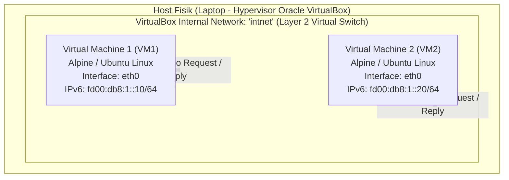
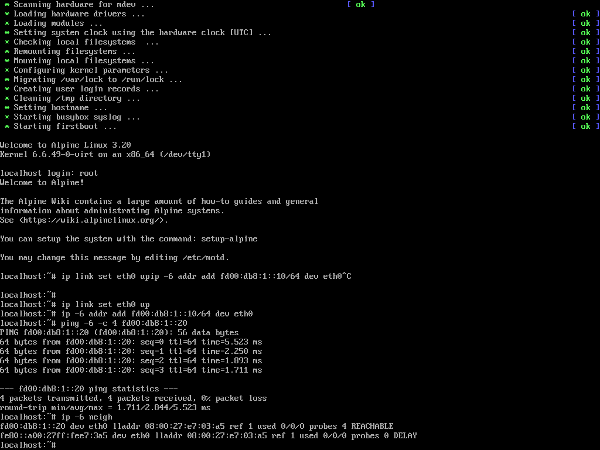
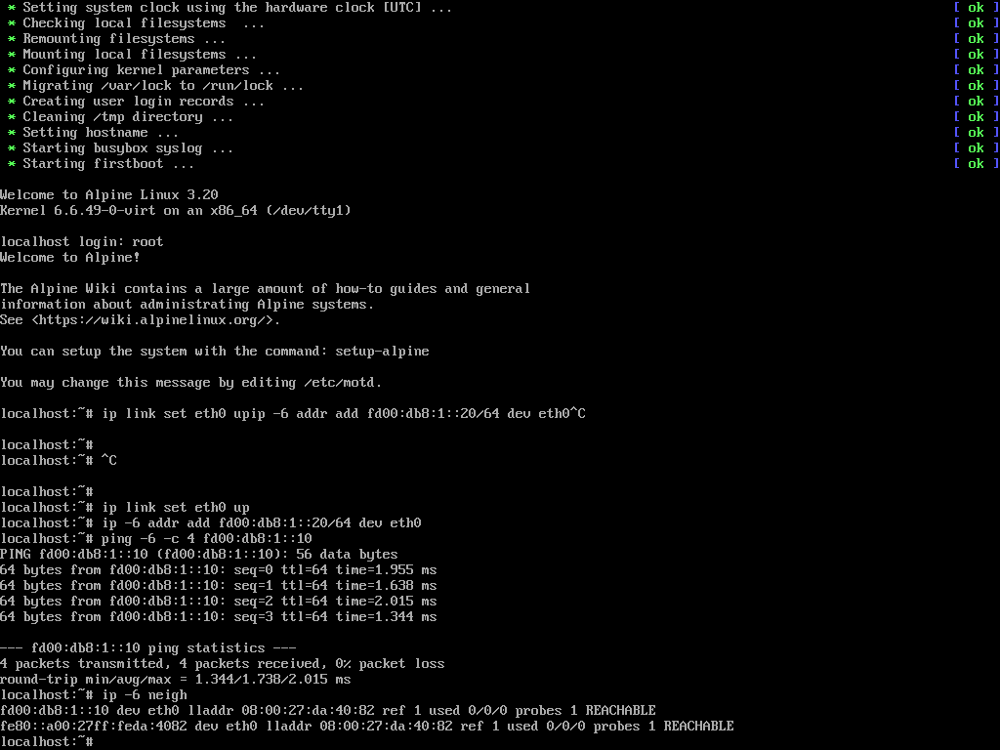

# Tugas 1 JARKOMLAN: Virtualisasi Hypervisor Tipe 2 & Implementasi Komunikasi IPv6

Repositori ini memuat berkas konfigurasi, laporan akademik, skrip otomasi, dan dokumentasi evaluasi **Tugas 1** pada mata kuliah **Jaringan Komputer dan LAN (JARKOMLAN)**.

Tugas ini mengimplementasikan lingkungan virtualisasi multi-node menggunakan **Hypervisor Tipe 2 (Oracle VirtualBox)** dan mengevaluasi komunikasi data antar-*Virtual Machine* (VM) menggunakan protokol **IPv6 Unique Local Address (ULA)** pada topologi jaringan terisolasi (*Internal Network*).

---

## Identitas Kelompok
- **Mata Kuliah:** Jaringan Komputer dan LAN
- **Topik:** Virtualisasi & Komunikasi Antar-VM Berbasis IPv6
- **Anggota Kelompok:**
  1. **Nicholas Benaya** — NIM: `5024241050`
  2. **Dzaky Haady** — NIM: `5024241076`
  3. **Alvis Shohan Fawwaz Nizar** — NIM: `5024241019`
  4. **Muhammad Sayyid Tsabit** — NIM: `5024241013`

---

## 1. Topologi Jaringan & Pengalamatan IPv6

Kedua VM berada pada switch virtual terisolasi (*Internal Network*) tanpa intervensi router eksternal, dengan alokasi prefix IPv6 ULA `fd00:db8:1::/64`:

### Tabel Pengalamatan Jaringan

| Atribut | Virtual Machine 1 (VM1) | Virtual Machine 2 (VM2) |
| :--- | :--- | :--- |
| **Hostname** | `vm1-jarkom` | `vm2-jarkom` |
| **Sistem Operasi Tamu** | Alpine Linux / Ubuntu Minimal | Alpine Linux / Ubuntu Minimal |
| **Tipe Adaptor Jaringan** | Internal Network (`intnet`) | Internal Network (`intnet`) |
| **Antarmuka (*Interface*)** | `eth0` | `eth0` |
| **IPv6 Unique Local Address**| `fd00:db8:1::10/64` | `fd00:db8:1::20/64` |
| **Protokol Evaluasi** | ICMPv6 (`ping -6`) | ICMPv6 (`ping -6`) |

---

## 2. Landasan Teori Singkat

### A. Alasan Pemilihan Hypervisor Tipe 2 (VirtualBox)
* **Fleksibilitas Akademik:** Berjalan sebagai aplikasi perangkat lunak (*hosted*) di atas Host OS (Windows 11) tanpa perlu memformat hard drive laptop (*bare-metal wipe* seperti pada VMware ESXi atau Proxmox).
* **Isolasi Switch Virtual (*Internal Network*):** Memungkinkan simulasi komunikasi layer 2/3 yang bersih, terisolasi dari DHCP atau broadcast Wi-Fi fisik.
* **Komparasi dengan Kontainer:** Berbeda dengan Docker yang berbagi kernel tunggal dengan host, VM mengemulasikan perangkat keras penuh dengan kernel independen untuk membuktikan tumpukan jaringan IPv6 native.

### B. Protokol IPv6 Unique Local Address (ULA)
Prefix `fd00::/8` (RFC 4193) merupakan padanan IPv6 untuk alamat privat IPv4 (RFC 1918), memungkinkan komunikasi lokal antar-node tanpa memerlukan alokasi publik dari ISP maupun translasi alamat NAT (*NAT-free routing*).

---

## 3. Bukti Pengujian Komunikasi Antar-VM

Pengujian dilakukan dua arah membuktikan konektivitas stabil dengan latensi rendah dan **0% packet loss**:

### 1. Uji Ping ICMPv6 dari VM1 ke VM2 (`fd00:db8:1::20`)

### 2. Uji Ping ICMPv6 dari VM2 ke VM1 (`fd00:db8:1::10`)

---

## 4. Skrip Otomasi Konfigurasi

Untuk mempermudah penyiapan antarmuka jaringan di dalam VM, disediakan skrip di dalam folder [`scripts/`](scripts/):
* **Linux Shell Scripts:**
  * [`scripts/setup_vm1.sh`](scripts/setup_vm1.sh) — Mengonfigurasi antarmuka `eth0` VM1 dengan alamat `fd00:db8:1::10/64`.
  * [`scripts/setup_vm2.sh`](scripts/setup_vm2.sh) — Mengonfigurasi antarmuka `eth0` VM2 dengan alamat `fd00:db8:1::20/64`.
* **PowerShell Automation (Host VirtualBox Control):**
  * [`scripts/setup_vm1.ps1`](scripts/setup_vm1.ps1) & [`scripts/setup_vm2.ps1`](scripts/setup_vm2.ps1) — Mengotomasi penyetelan kartu jaringan VirtualBox melalui `VBoxManage`.

---

## 5. Navigasi Berkas Tugas 1

- 📄 **[LAPORAN_TUGAS_1_JARKOMLAN.md](LAPORAN_TUGAS_1_JARKOMLAN.md)**: Laporan akademik formal lengkap dengan komparasi mendalam OS, arsitektur hypervisor, dan evaluasi paket IPv6.
- 📘 **[PANDUAN_TUGAS_DAN_DEMO.md](PANDUAN_TUGAS_DAN_DEMO.md)**: Matriks keputusan rekayasa sistem (*engineering decision matrix*) dan materi presentasi demonstrasi lab.
- 📁 **[`scripts/`](scripts/)**: Berkas otomasi konfigurasi jaringan Shell dan PowerShell.
- 📁 **[`screenshots/`](screenshots/)**: Arsip visual hasil pengujian dan tangkapan layar terminal VM.
