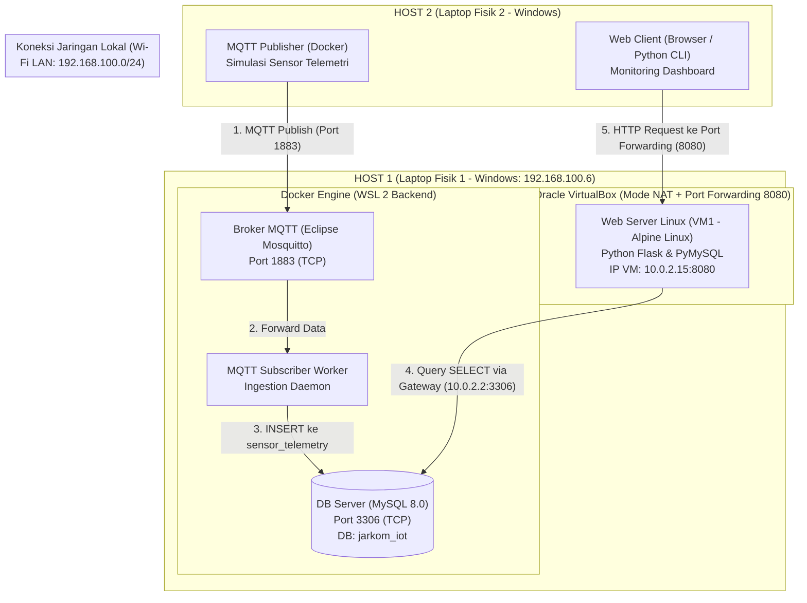
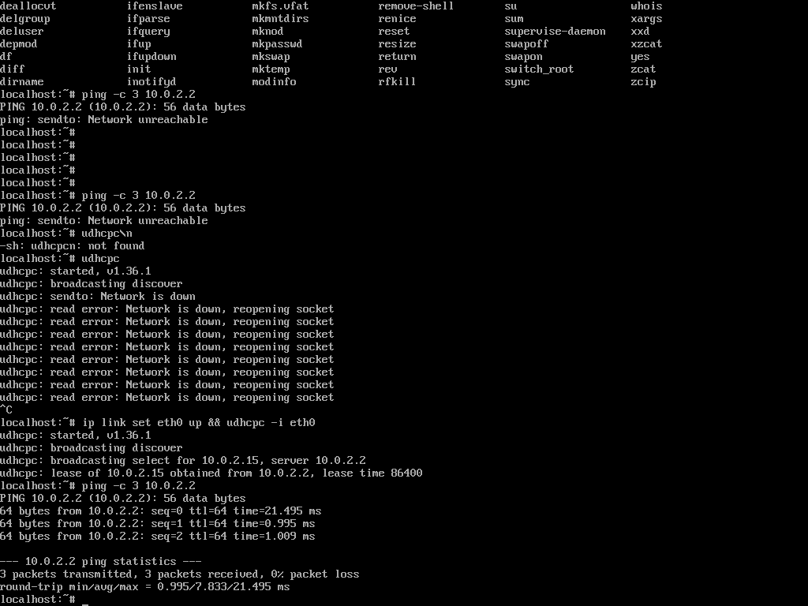
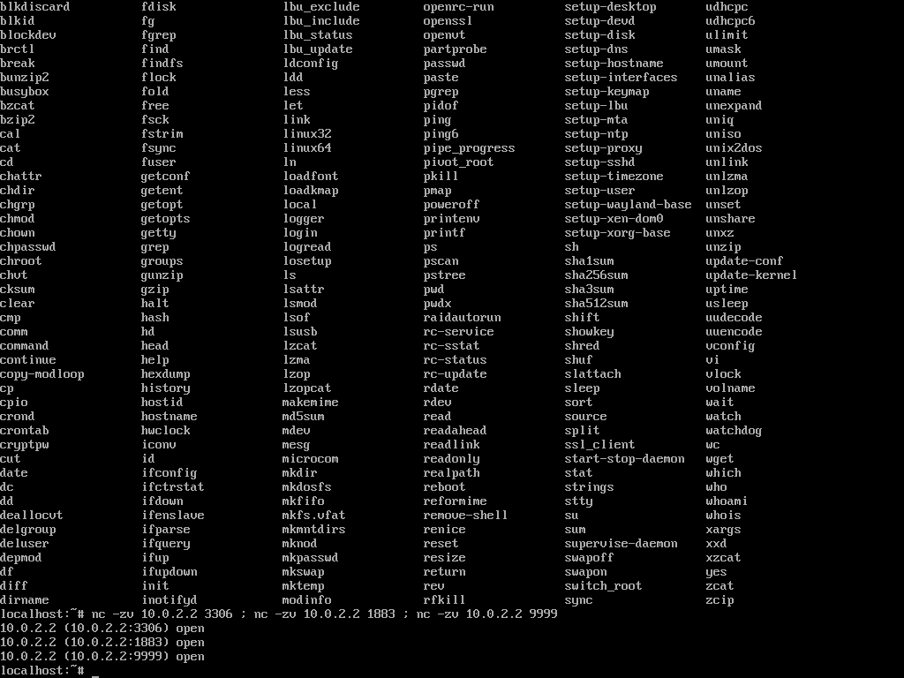
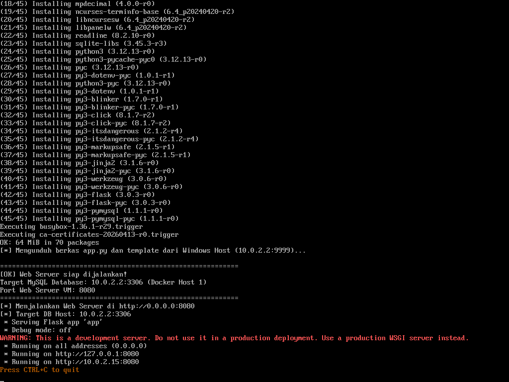
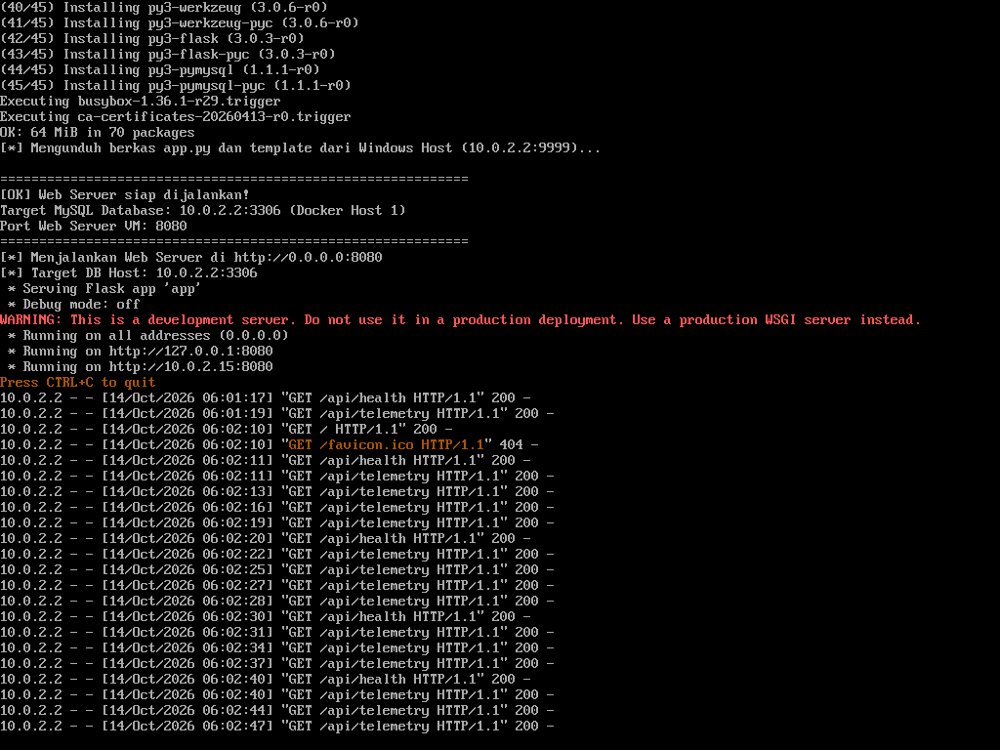

# Tugas 2 JARKOMLAN: Arsitektur IoT Terdistribusi (Multi-Host, Docker WSL 2, & Linux VM Web Server)

Repositori ini memuat implementasi, konfigurasi orkestrasi, kontrak normalisasi data, dan dokumentasi evaluasi **Tugas 2** pada mata kuliah **Jaringan Komputer dan LAN (JARKOMLAN)**. 

Tugas ini mengimplementasikan sistem telemetri IoT terdistribusi lintas perangkat (*cross-device*) yang menggabungkan teknologi kontainerisasi (**Docker di atas WSL 2**) dan virtualisasi hypervisor (**VirtualBox Linux VM**) untuk menghasilkan pipeline penyerapan data (*data ingestion*) yang terisolasi dan modular.

---

## Identitas Kelompok
- **Mata Kuliah:** Jaringan Komputer dan LAN
- **Topik:** Sistem Terdistribusi Multi-Host (MQTT, MySQL, Docker WSL 2, & Virtual Machine)
- **Anggota Kelompok:**
  1. **Nicholas Benaya** — NIM: `5024241050`
  2. **Dzaky Haady** — NIM: `5024241076`
  3. **Alvis Shohan Fawwaz Nizar** — NIM: `5024241019`
  4. **Muhammad Sayyid Tsabit** — NIM: `5024241013`

---

## 1. Topologi & Arsitektur Sistem Terdistribusi

Sistem dibagi menjadi dua host fisik independen yang saling berkomunikasi melalui jaringan area lokal (LAN):



---

## 2. Rincian Layanan & Pengalamatan Jaringan

| Komponen | Host | Lingkungan Eksekusi | Alamat IP / Interface | Port | Protokol & Peran |
| :--- | :--- | :--- | :--- | :--- | :--- |
| **MQTT Broker** | Host 1 | Docker Container | `0.0.0.0:1883` | `1883` | TCP / Ingestion Broker (Eclipse Mosquitto 2.0) |
| **Database Server**| Host 1 | Docker Container | `0.0.0.0:3306` | `3306` | TCP / Data Persistence (MySQL 8.0, DB: `jarkom_iot`) |
| **Subscriber** | Host 1 | Docker Container | Jaringan internal Docker | - | TCP Client / Listener MQTT & Ingestion ke MySQL |
| **Web Server** | Host 1 | **Alpine Linux VM** | `10.0.2.15` (Forward: `8080`) | `8080` | HTTP / Dashboard Monitoring Telemetri |
| **Gateway Host**| Host 1 | VirtualBox NAT | `10.0.2.2` | - | Gerbang komunikasi VM menuju Windows Host |
| **Publisher** | Host 2 | Docker Container | LAN (`192.168.100.x`) | Outbound | TCP Client / Mengirim data periodik ke Host 1 |
| **Web Client** | Host 2 | Browser / CLI | LAN (`192.168.100.x`) | Outbound | HTTP Client / Menampilkan data dari Web Server |

---

## 3. Normalisasi & Kontrak Pertukaran Data (Anti-Konflik)

Untuk mencegah kegagalan integrasi lintas perangkat (*parsing error*, *type mismatch*, atau inkonsistensi nilai), sistem menerapkan kontrak data yang mengikat:

### A. Kontrak Payload JSON (Data In-Flight)
Setiap paket yang dikirimkan oleh Publisher wajib mematuhi skema berikut:
```json
{
  "device_id": "HOST2-IOT-NODE",
  "seq": 1,
  "temperature": 29.40,
  "humidity": 68.10,
  "voltage": 3.32,
  "source": "Host 2 Windows Docker Container"
}
```

### B. Normalisasi Database MySQL (3NF)
Data yang diserap dipetakan ke dalam tabel `sensor_telemetry`:
```sql
CREATE TABLE IF NOT EXISTS sensor_telemetry (
    id INT AUTO_INCREMENT PRIMARY KEY,
    device_id VARCHAR(64) NOT NULL,
    topic VARCHAR(128) NOT NULL,
    temperature DECIMAL(5, 2) DEFAULT NULL,
    humidity DECIMAL(5, 2) DEFAULT NULL,
    voltage DECIMAL(4, 2) DEFAULT NULL,
    raw_payload TEXT,
    created_at TIMESTAMP DEFAULT CURRENT_TIMESTAMP,
    INDEX idx_device (device_id),
    INDEX idx_created (created_at)
) ENGINE=InnoDB DEFAULT CHARSET=utf8mb4;
```
- **1NF:** Seluruh atribut bernilai atomik (atribut suhu, kelembapan, tegangan terpisah secara mandiri).
- **2NF:** Seluruh atribut non-kunci bergantung secara fungsional penuh pada Primary Key (`id`).
- **3NF:** Tidak terdapat ketergantungan transitif antar-atribut non-kunci.

---

## 4. Bukti Hasil Pengujian & Verifikasi

### 1. Uji ICMP Ping Layer 3 (VM ke Gateway Host `10.0.2.2`)
Pengujian membuktikan saluran virtual antara Linux VM dan Windows Host terhubung stabil dengan **0% packet loss**:


### 2. Uji Layer 4 Transport (Netcat ke Port Service MySQL & Mosquitto)
Pengujian membuktikan seluruh port layanan di Host 1 terbuka dan siap menerima koneksi dari dalam VM:


### 3. Eksekusi Web Server di dalam VM Alpine Linux
Web server Flask berhasil dijalankan di dalam VM Alpine Linux pada port 8080 dan terhubung ke MySQL Host 1:


### 4. Log Akses Real-Time HTTP Web Server di VM
Terminal VM mencatat setiap permintaan data `GET 200 OK` secara langsung saat browser menampilkan data sensor:


---

## 5. Navigasi Berkas Proyek

- 📘 **[PANDUAN_DEMO_HOST1.md](PANDUAN_DEMO_HOST1.md)**: Skenario demonstrasi langkah demi langkah, panduan berbicara saat presentasi, dan tanya-jawab teknis.
- 📄 **[PANDUAN_DELEGASI_HOST2.pdf](PANDUAN_DELEGASI_HOST2.pdf)**: Dokumen SOP formal delegasi tugas dan kontrak normalisasi data untuk anggota pemegang Host 2.
- 📁 **`host1/`**: Kode sumber, berkas `docker-compose.yml`, skrip startup VM, dan firewall rule untuk Host 1.
- 📁 **`host2/`**: Container Docker Publisher dan script test web client untuk Host 2.
- 📁 **`screenshots/`**: Tangkapan layar autentik hasil eksekusi pengujian di VM dan Docker.
