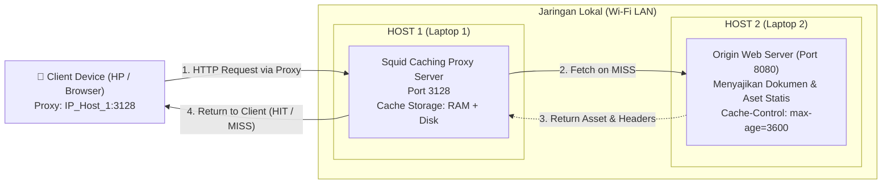
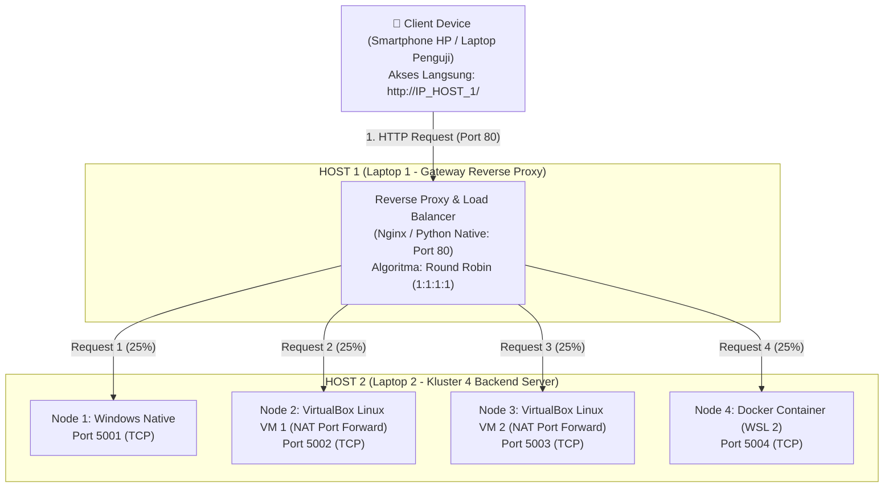

# Tugas 3 JARKOMLAN: Implementasi Cached Proxy (Squid) & Reverse Proxy Load Balancer (Nginx)

Repositori ini memuat arsitektur sistem, berkas konfigurasi jaringan, skrip otomasi pengujian, dan panduan operasional **Tugas 3** pada mata kuliah **Jaringan Komputer dan LAN (JARKOMLAN)**.

Tugas ini mengimplementasikan dua konsep fundamental perantara lalu lintas jaringan (*network proxies*):
1. **Cached Proxy (Forward Proxy)** menggunakan **Squid Proxy Server** untuk melakukan intersepsi, penyimpanan objek web sementara (*caching*), akselerasi akses, serta penghematan *bandwidth*.
2. **Reverse Proxy & Load Balancer** menggunakan **Nginx** di depan kluster server aplikasi terdistribusi multi-lingkungan (**Windows Native, 2 VirtualBox Linux VM, dan Docker Container**) untuk mendistribusikan beban lalu lintas secara merata menggunakan algoritma *Round Robin*.

---

## Identitas Kelompok
- **Mata Kuliah:** Jaringan Komputer dan LAN
- **Topik:** Cached Proxy (Squid) & Reverse Proxy Load Balancing (Nginx)
- **Anggota Kelompok:**
  1. **Nicholas Benaya** — NIM: `5024241050`
  2. **Dzaky Haady** — NIM: `5024241076`
  3. **Alvis Shohan Fawwaz Nizar** — NIM: `5024241019`
  4. **Muhammad Sayyid Tsabit** — NIM: `5024241013`

---

## 1. Topologi & Arsitektur Sistem

Arsitektur dirancang menggunakan **2 Laptop Fisik (Host 1 & Host 2)** serta **1 Smartphone (HP)** sebagai klien nyata di jaringan Wi-Fi LAN yang sama:

### A. Sub-Tugas 1: Topologi Cached Proxy (Forward Proxy)
Forward Proxy berdiri di antara klien (*end-user*) dan server tujuan untuk mengoptimalkan permintaan unduhan.



---

### B. Sub-Tugas 2: Topologi Reverse Proxy & Load Balancer
Reverse Proxy berdiri di **Host 1** sebagai pintu gerbang tunggal yang menerima permintaan klien (HP/Browser). Kemudian Host 1 mendistribusikan beban (*load balancing*) ke **kluster 4 server backend yang berjalan di Host 2** (Windows Native, 2 VM VirtualBox, dan Docker Container).



---

## 2. Matriks Pengalamatan Jaringan & Port Layanan

| Peran | Host Fisik | Komponen / Platform | Port | Protokol | Fungsi Utama |
| :--- | :--- | :--- | :--- | :--- | :--- |
| **Forward Proxy** | Host 1 | Squid Proxy Server | `3128` | HTTP/TCP | Caching proxy untuk Client HP |
| **Origin Web Server** | Host 2 | Python Origin Server | `8080` | HTTP/TCP | Server sumber konten untuk Cached Proxy |
| **Reverse Proxy** | Host 1 | Nginx / Python Native | `80` | HTTP/TCP | Pintu masuk tunggal & distributor beban |
| **Backend Node 1** | Host 2 | Windows Native Python | `5001` | HTTP/TCP | Eksekusi server langsung di OS Windows |
| **Backend Node 2** | Host 2 | VirtualBox VM 1 (Linux) | `5002` | HTTP/TCP | Eksekusi server di VM 1 (Forwarding 5002) |
| **Backend Node 3** | Host 2 | VirtualBox VM 2 (Linux) | `5003` | HTTP/TCP | Eksekusi server di VM 2 (Forwarding 5003) |
| **Backend Node 4** | Host 2 | Docker Container | `5004` | HTTP/TCP | Eksekusi server berbasis kontainer Docker |
| **External Tester** | Host 1 / Host 2 | Benchmark Script | Outbound | HTTP | Mengirim dummy request uji load balancing |
| **Real Client** | Smartphone | Browser Chrome / Safari | Outbound | HTTP | Menguji respon visual & perputaran kartu node |

---

## 3. Konsep Teoretis & Mekanisme Kerja

### A. Cached Proxy (Squid)
- **Apa itu Squid?** Squid adalah aplikasi proxy dan cache berkinerja tinggi. Squid bertindak sebagai penengah antara klien dan internet atau server lokal.
- **Cache MISS:** Terjadi ketika objek yang diminta klien belum pernah disimpan di memori/disk Squid. Squid di Host 1 akan meneruskan request ke Origin Web Server di Host 2, mengunduhnya, menyimpan salinannya, lalu menyerahkannya ke klien.
- **Cache HIT:** Terjadi ketika objek yang diminta sudah ada di penyimpanan lokal Squid dan masa berlakunya masih valid (*fresh*). Squid langsung merespons ke klien tanpa menghubungi server asal di Host 2, mengeliminasi beban jaringan ke server tujuan.
- **Header `Cache-Control`:** Origin Server di Host 2 menyematkan header `Cache-Control: public, max-age=3600` yang memberikan otoritas kepada Squid untuk menyimpan konten selama 1 jam.

### B. Reverse Proxy & Load Balancing
- **Host 1 sebagai Gerbang Tunggal (Reverse Proxy):** Klien luar (HP) hanya mengetahui satu alamat IP publik/gateway (yaitu IP Host 1 port 80). Klien sama sekali tidak mengetahui keberadaan IP dan port 4 backend di Host 2 (*security through obscurity*).
- **Host 2 sebagai Pusat Server Aplikasi (Backend Cluster):** Menjalankan 4 instance server aplikasi di lingkungan yang terisolasi: Windows Native (`:5001`), VM 1 Linux (`:5002`), VM 2 Linux (`:5003`), dan Docker Container (`:5004`).
- **Algoritma Round Robin:** Reverse Proxy mendistribusikan permintaan secara bergiliran ke 4 port di Host 2: `Node 1 -> Node 2 -> Node 3 -> Node 4 -> Node 1 -> ...`.
- **Failover / High Availability:** Jika salah satu node di Host 2 mati (misal VM 1 dimatikan), Reverse Proxy secara otomatis mendeteksi kegagalan tersebut dan mengalihkan request ke 3 node lainnya yang masih sehat.

---

## 4. Pembagian Peran Kelompok (4 Orang)

| Anggota Tim | Peran Utama | Tanggung Jawab Operasional |
| :--- | :--- | :--- |
| **Anggota 1** | **Host 1 Proxy Operator** | • Mengelola Reverse Proxy di Host 1 (Port 80) & Squid Proxy (Port 3128)<br>• Memantau log akses real-time (`access.log` Squid & Proxy) |
| **Anggota 2** | **Host 2 Cluster Operator** | • Mengelola 4 backend di Host 2 (Windows, VM 1, VM 2, Docker)<br>• Memastikan port 5001–5004 terbuka dan firewall mengizinkan koneksi dari Host 1 |
| **Anggota 3** | **Host 2 Origin Server Lead** | • Menjalankan Origin Web Server (Port 8080) di Host 2<br>• Menjalankan skrip benchmarking `run_load_test.bat` |
| **Anggota 4** | **Client Testing & Documentation Lead** | • Mengatur manual proxy pada HP untuk demo live<br>• Menampilkan rotasi kartu node di browser HP ke dosen saat demo |

---

## 5. Cara Menjalankan Sistem

### Langkah 1: Persiapan Jaringan
1. Hubungkan Laptop Host 1, Laptop Host 2, dan Smartphone (HP) ke jaringan Wi-Fi yang sama (bisa menggunakan hotspot HP).
2. Periksa IP masing-masing menggunakan perintah `ipconfig` (Windows).
   * Contoh: Host 1 = `192.168.100.10`, Host 2 = `192.168.100.20`.

### Langkah 2: Menjalankan Host 2 (Kluster 4 Backend Server)
1. Di folder `tugas-3/host2/`, double-click:
   👉 [`start_cluster.bat`](host2/start_cluster.bat)
   *Skrip ini akan otomatis menyalakan Node 1 (Windows: port 5001) dan Node 4 (Docker: port 5004).*
2. Di dalam terminal VirtualBox Linux masing-masing pada Host 2, jalankan:
   * Di VM 1: `sh server_vm.sh 5002 "Node 2 - Linux VM 1" "#22c55e"`
   * Di VM 2: `sh server_vm.sh 5003 "Node 3 - Linux VM 2" "#eab308"`

### Langkah 3: Menjalankan Host 1 (Reverse Proxy & Load Balancer)
1. Di folder `tugas-3/host1/`, double-click:
   👉 [`start_reverse_proxy.bat`](host1/start_reverse_proxy.bat)
2. Masukkan alamat IP Host 2 (contoh `192.168.100.20`).
3. Pilih opsi `[1]` (Python Native) atau `[2]` (Nginx Docker). Reverse Proxy langsung aktif di port 80!

### Langkah 4: Uji Coba dari Smartphone (HP)
1. Buka browser di HP, ketik URL: `http://<IP_HOST_1>/` (Port 80 Host 1).
2. Tekan tombol **Refresh** berulang kali. Anda akan melihat kartu identitas berpindah secara bergantian antara Node 1, Node 2, Node 3, dan Node 4 di Host 2!
3. Jalankan pengujian beban otomatis (benchmark 40 request):
   * Di folder `tugas-3/host2/`, double-click:
     👉 [`run_load_test.bat`](host2/run_load_test.bat)
   * Masukkan URL target: `http://<IP_HOST_1>/`

### Langkah 5: Opsi Pengujian Online Jarak Jauh (Pinggy Tunneling)
Jika ingin melakukan pengujian dari HP dengan paket data seluler (4G/5G) atau demo jarak jauh via Zoom / Google Meet:
1. Di Host 1, double-click [`start_tunnel_online.bat`](start_tunnel_online.bat).
2. Pilih opsi `[1]` untuk membuka Reverse Proxy ke internet publik.
3. Salin tautan HTTPS publik yang muncul ke HP Anda (atau bagikan ke dosen di Zoom chat).
4. Panduan lengkap tersedia di: 📘 **[PANDUAN_DEMO_ONLINE.md](PANDUAN_DEMO_ONLINE.md)**.

---

## 6. Struktur Direktori Proyek

```
tugas-3/
├── README.md                      # Dokumentasi komprehensif arsitektur & teori
├── PANDUAN_TUGAS_3_DAN_DEMO.md    # Panduan langkah demi langkah dan naskah demo lokal
├── PANDUAN_DEMO_ONLINE.md         # Panduan pengujian jarak jauh / internet tunneling
├── start_tunnel_online.bat        # Skrip 1-klik otomasi tunneling publik Pinggy
├── host1/                         # Lingkungan Host 1 (Pusat Proxy Server)
│   ├── reverse_proxy_native.py    # Reverse Proxy Load Balancer Native Python (Port 80)
│   ├── start_reverse_proxy.bat    # 1-klik runner Reverse Proxy (Meneruskan ke Host 2)
│   ├── nginx/                     # Konfigurasi Nginx Reverse Proxy (Docker Port 80)
│   ├── squid/                     # Squid Caching Proxy (Port 3128)
│   └── start_squid.bat            # 1-klik runner Squid Proxy
└── host2/                         # Lingkungan Host 2 (Pusat Aplikasi & Backend Cluster)
    ├── server_node.py             # Server aplikasi HTTP Node 1 (Windows: 5001)
    ├── start_cluster.bat / .ps1   # Otomasi startup cluster Windows & Docker
    ├── setup_vbox_network.ps1     # Otomasi Port Forwarding VirtualBox NAT
    ├── server_vm.sh               # Runner server node untuk VM 1 & VM 2
    ├── docker/                    # Node 4 Container Web Server (Port 5004)
    ├── origin_web/                # Origin Web Server sumber cache (Port 8080)
    ├── start_origin_server.bat    # 1-klik runner Origin Web Server
    ├── test_dummy_requests.py     # Skrip benchmarking penguji beban dummy
    └── run_load_test.bat          # 1-klik runner pengujian beban ke Host 1
```
│   ├── server_node.py             # Script server aplikasi HTTP (HTML & JSON API)
│   ├── start_cluster.ps1          # Otomasi startup cluster Windows & Docker
│   ├── docker/
│   │   ├── Dockerfile             # Container definition untuk Node 4
│   │   └── docker-compose.yml     # Compose file Node 4 (Port 5004)
│   └── squid/
│       ├── squid.conf             # Konfigurasi caching, ACL, dan storage Squid
│       └── docker-compose.yml     # Menjalankan Squid Proxy via Docker
└── host2/                         # Lingkungan Host 2 (Reverse Proxy & Origin Server)
    ├── test_dummy_requests.py     # Skrip benchmark dummy requests otomatis
    ├── nginx/
    │   ├── nginx.conf             # Konfigurasi Nginx Reverse Proxy (Round Robin)
    │   └── docker-compose.yml     # Menjalankan Nginx via Docker (Port 80)
    └── origin_web/
        ├── index.html             # Halaman web uji coba caching
        └── origin_server.py       # Origin Web Server dengan header Cache-Control
```
