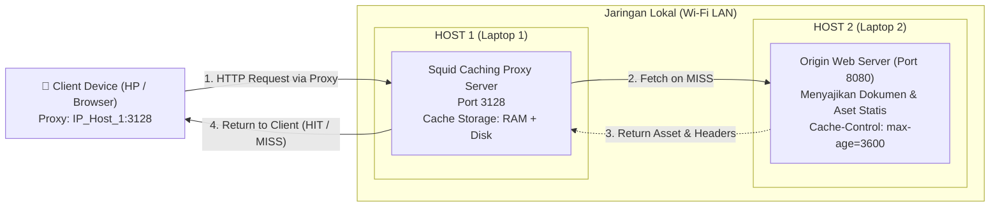
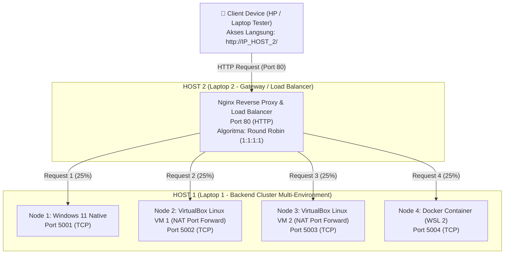

# Tugas 3 JARKOMLAN: Implementasi Cached Proxy (Squid) & Reverse Proxy Load Balancer (Nginx)

Repositori ini memuat arsitektur sistem, berkas konfigurasi jaringan, skrip otomasi pengujian, dan panduan operasional **Tugas 3** pada mata kuliah **Jaringan Komputer dan LAN (JARKOMLAN)**.

Tugas ini mengimplementasikan dua konsep fundamental perantara lalu lintas jaringan (*network proxies*):
1. **Cached Proxy (Forward Proxy)** menggunakan **Squid Proxy Server** untuk melakukan intersepsi, penyimpanan objek web sementara (*caching*), akselerasi akses, serta penghematan *bandwidth*.
2. **Reverse Proxy & Load Balancer** menggunakan **Nginx** di depan kluster server aplikasi terdistribusi multi-lingkungan (**Windows Native, 2 VirtualBox Linux VM, dan Docker Container**) untuk mendistribusikan beban lalu lintas secara merata menggunakan algoritma *Round Robin*.

---

## Identitas Kelompok
- **Mata Kuliah:** Jaringan Komputer dan LAN
- **Topik:** Cached Proxy (Squid) & Reverse Proxy Load Balancing (Nginx)
- **Anggota Kelompok:**
  1. **Nicholas Benaya** — NIM: `5024241050`
  2. **Dzaky Haady** — NIM: `5024241076`
  3. **Alvis Shohan Fawwaz Nizar** — NIM: `5024241019`
  4. **Muhammad Sayyid Tsabit** — NIM: `5024241013`

---

## 1. Topologi & Arsitektur Sistem

Arsitektur dirancang menggunakan **2 Laptop Fisik (Host 1 & Host 2)** serta **1 Smartphone (HP)** sebagai klien nyata di jaringan Wi-Fi LAN yang sama:

### A. Sub-Tugas 1: Topologi Cached Proxy (Forward Proxy)
Forward Proxy berdiri di antara klien (*end-user*) dan server tujuan untuk mengoptimalkan permintaan unduhan.



---

### B. Sub-Tugas 2: Topologi Reverse Proxy & Load Balancer
Reverse Proxy berdiri di depan kluster server backend untuk menyembunyikan arsitektur internal dan membagi beban permintaan (*load balancing*).



---

## 2. Matriks Pengalamatan Jaringan & Port Layanan

| Peran | Host Fisik | Komponen / Platform | Port | Protokol | Fungsi Utama |
| :--- | :--- | :--- | :--- | :--- | :--- |
| **Forward Proxy** | Host 1 | Squid Proxy Server | `3128` | HTTP/TCP | Caching proxy untuk Client HP |
| **Origin Web Server** | Host 2 | Python / Nginx Origin | `8080` | HTTP/TCP | Server sumber konten untuk Cached Proxy |
| **Reverse Proxy** | Host 2 | Nginx Load Balancer | `80` | HTTP/TCP | Pintu masuk tunggal & distributor beban |
| **Backend Node 1** | Host 1 | Windows Native Python | `5001` | HTTP/TCP | Eksekusi server langsung di OS Windows |
| **Backend Node 2** | Host 1 | VirtualBox VM 1 (Linux) | `5002` | HTTP/TCP | Eksekusi server di VM 1 (Forwarding 5002) |
| **Backend Node 3** | Host 1 | VirtualBox VM 2 (Linux) | `5003` | HTTP/TCP | Eksekusi server di VM 2 (Forwarding 5003) |
| **Backend Node 4** | Host 1 | Docker Container | `5004` | HTTP/TCP | Eksekusi server berbasis kontainer Docker |
| **Real Client** | Smartphone | Browser Chrome / Safari | Outbound | HTTP | Menguji respon visual & perputaran node |

---

## 3. Konsep Teoretis & Mekanisme Kerja

### A. Cached Proxy (Squid)
- **Apa itu Squid?** Squid adalah aplikasi proxy dan cache berkinerja tinggi. Squid bertindak sebagai penengah antara klien dan internet atau server lokal.
- **Cache MISS:** Terjadi ketika objek yang diminta klien belum pernah disimpan di memori/disk Squid. Squid akan meneruskan request ke Origin Web Server, mengunduhnya, menyimpan salinannya, lalu menyerahkannya ke klien.
- **Cache HIT:** Terjadi ketika objek yang diminta sudah ada di penyimpanan lokal Squid dan masa berlakunya masih valid (*fresh*). Squid langsung merespons ke klien tanpa menghubungi server asal, mengeliminasi beban jaringan ke server tujuan.
- **Header `Cache-Control`:** Origin Server menyematkan header `Cache-Control: public, max-age=3600` yang memberikan otoritas kepada Squid untuk menyimpan konten selama 1 jam.

### B. Reverse Proxy & Load Balancing (Nginx)
- **Pintu Gerbang Tunggal:** Klien luar (HP) hanya mengetahui satu alamat IP publik/gateway (yaitu IP Host 2 port 80). Klien sama sekali tidak mengetahui keberadaan IP dan port backend di Host 1 (*security through obscurity*).
- **Algoritma Round Robin:** Nginx mendistribusikan permintaan secara bergiliran menurut daftar `upstream` yang didefinisikan. Jika ada 4 server, maka urutan distribusi adalah `Node 1 -> Node 2 -> Node 3 -> Node 4 -> Node 1 -> ...`.
- **Failover / High Availability:** Jika salah satu node mati (misal VM 1 dimatikan), Nginx secara otomatis mendeteksi kegagalan tersebut (`max_fails=3 fail_timeout=10s`) dan mengalihkan request ke 3 node yang masih sehat tanpa menimbulkan *downtime* pada sisi klien.

---

## 4. Pembagian Peran Kelompok (4 Orang)

| Anggota Tim | Peran Utama | Tanggung Jawab Operasional |
| :--- | :--- | :--- |
| **Anggota 1** | **Host 1 Cluster Operator** | • Mengelola 4 backend di Host 1 (Windows, VM 1, VM 2, Docker)<br>• Memastikan port 5001–5004 terbuka dan firewall mengizinkan koneksi dari LAN |
| **Anggota 2** | **Host 2 Proxy & Gateway Operator** | • Mengonfigurasi `nginx.conf` di Host 2 sesuai IP LAN Host 1<br>• Menjalankan Nginx Load Balancer dan Origin Server (port 8080) |
| **Anggota 3** | **Squid & Caching Specialist** | • Mengonfigurasi `squid.conf` di Host 1 port 3128<br>• Menganalisis log Squid (`access.log`) untuk memvalidasi `TCP_HIT` vs `TCP_MISS` |
| **Anggota 4** | **Client Testing & Benchmarking Lead** | • Mengatur manual proxy pada HP untuk demo live<br>• Menjalankan skrip `test_dummy_requests.py` untuk mengukur persentase beban |

---

## 5. Cara Menjalankan Sistem

### Langkah 1: Persiapan Jaringan
1. Hubungkan Laptop Host 1, Laptop Host 2, dan Smartphone (HP) ke jaringan Wi-Fi yang sama (bisa menggunakan hotspot HP).
2. Periksa IP masing-masing menggunakan perintah `ipconfig` (Windows) atau `ip a` (Linux).
   * Contoh: Host 1 = `192.168.100.10`, Host 2 = `192.168.100.20`.

### Langkah 2: Menjalankan Host 1 (Backend Cluster)
1. Buka PowerShell di folder `tugas-3/host1/`:
   ```powershell
   .\start_cluster.ps1
   ```
2. Jalankan Node 2 dan Node 3 di dalam terminal VirtualBox Linux masing-masing:
   ```bash
   python3 server_node.py --port 5002 --name "Node 2 - Linux VM 1" --platform "VirtualBox VM 1" --color "#22c55e"
   python3 server_node.py --port 5003 --name "Node 3 - Linux VM 2" --platform "VirtualBox VM 2" --color "#eab308"
   ```

### Langkah 3: Menjalankan Host 2 (Reverse Proxy Nginx)
1. Buka file `tugas-3/host2/nginx/nginx.conf`, sesuaikan alamat IP di bagian `upstream backend_nodes` dengan IP Host 1 Anda.
2. Jalankan Nginx via Docker:
   ```bash
   cd tugas-3/host2/nginx
   docker compose up -d
   ```

### Langkah 4: Uji Coba dari Smartphone (HP)
1. Buka browser di HP, ketik URL: `http://<IP_HOST_2>/`
2. Tekan tombol **Refresh** berulang kali. Anda akan melihat kartu identitas berpindah secara bergantian antara Node 1, Node 2, Node 3, dan Node 4!
3. Jalankan pengujian beban otomatis dari terminal Host 2:
   ```bash
   python test_dummy_requests.py --url http://localhost/ -n 40
   ```

---

## 6. Struktur Direktori Proyek

```
tugas-3/
├── README.md                      # Dokumentasi komprehensif arsitektur & teori
├── PANDUAN_TUGAS_3_DAN_DEMO.md    # Panduan langkah demi langkah dan naskah demo
├── host1/                         # Lingkungan Host 1 (Backend Cluster & Squid)
│   ├── server_node.py             # Script server aplikasi HTTP (HTML & JSON API)
│   ├── start_cluster.ps1          # Otomasi startup cluster Windows & Docker
│   ├── docker/
│   │   ├── Dockerfile             # Container definition untuk Node 4
│   │   └── docker-compose.yml     # Compose file Node 4 (Port 5004)
│   └── squid/
│       ├── squid.conf             # Konfigurasi caching, ACL, dan storage Squid
│       └── docker-compose.yml     # Menjalankan Squid Proxy via Docker
└── host2/                         # Lingkungan Host 2 (Reverse Proxy & Origin Server)
    ├── test_dummy_requests.py     # Skrip benchmark dummy requests otomatis
    ├── nginx/
    │   ├── nginx.conf             # Konfigurasi Nginx Reverse Proxy (Round Robin)
    │   └── docker-compose.yml     # Menjalankan Nginx via Docker (Port 80)
    └── origin_web/
        ├── index.html             # Halaman web uji coba caching
        └── origin_server.py       # Origin Web Server dengan header Cache-Control
```
